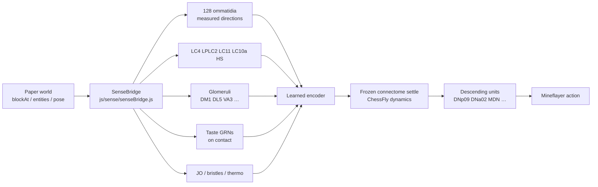
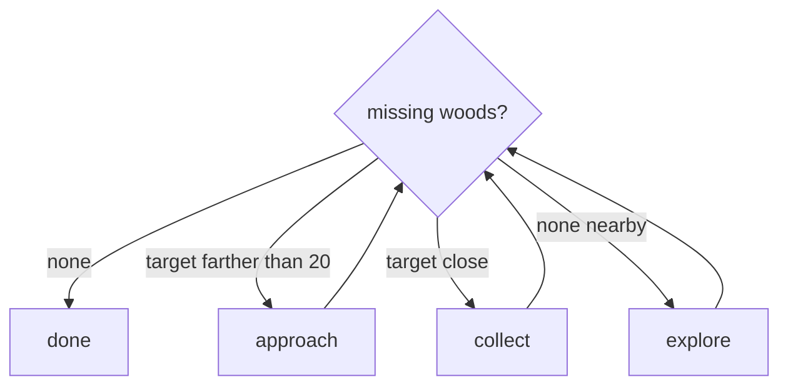

# Wood Collector Bot

A Mineflayer bot in a local Paper 1.21.11 world. Two stacked agents share that body:

1. **Lumberjack** — checklist hunter for one of each overworld log. Chat `go`.
2. **FruitFly** — the same world, rewritten into named *Drosophila* senses, then a frozen male-cns connectome that picks discrete walk / turn / mine actions.

Minecraft is never fed in as pixels, block IDs, or a “wood enum.” Goals add extra current on that same sensory frame. Contract: [AGENTS.md](AGENTS.md). Provenance of the sense tables: [docs/SENSE_PROVENANCE.md](docs/SENSE_PROVENANCE.md).

## Quick start

Needs **Node 22+**, **Python 3.12+**, [**uv**](https://docs.astral.sh/uv/), and **Java 21** (or Docker) for Paper.

```bash
./start-server.sh          # Paper 1.21.11 on 127.0.0.1:25565
npm install
uv sync --group dev
```

Copy `.env.example` to `.env` and put `WANDB_API_KEY=` there if you train. Do not commit `.env`.

| What | Command |
|------|---------|
| Lumberjack | `node bot.js`, then chat `go` |
| FruitFly explore | `node fly.js` — chat `stop` / `explore` / `log` |
| Live policy | `uv run python python/play.py --fresh` |
| Tests | `npm test` and `uv run pytest` |

Join the same world from TLauncher (or any client) at `127.0.0.1:25565`. Live board while `play.py` / `train.py` is running: **http://127.0.0.1:8766/**

Op the bot once in the server console (`op Lumberjack` or `op FruitFly`) so spawn kit and scale commands work.

## Fruit-fly policy

Mineflayer samples the live Paper world (`blockAt`, entities, pose, contact). That sample is compiled into a `SensoryFrame` the fly already has language for: photoreceptors, glomeruli, GRNs, LC/HS object cells, Johnston’s organ, bristles. A `GoalSpec` only adds drive on those same channels. Rarest-log collection is an outer loop (census → pick an existing spec), not a feature in the observation.

The RGB / orbit view on the dashboard is **for us**. The policy still only sees luminance plus the other mapped senses.



**Principle:** map world physics onto fly physics. Never invent a “chicken neuron” or a “wood neuron.” A chicken is a nearby blob with size and motion → it can raise `LC11`. Oak is a block class with a green-leaf odor row → it raises `DL5` / `DM1` / `VA3`. The connectome only ever sees those fly names.

### Vision

The policy does not receive an RGB frame. It receives **128 luminance samples** along measured ommatidial directions (`configs/sense/retina_columns.json`, from the male-cns / Zhao micro-CT eye map). Azimuth 0 is ahead, **+ is the fly’s right**. Hits become intensity (`light/15 × day × albedo`); misses are sky or ground; nearby mobs darken overlapping rays. Photoreceptors depolarize to light and are histaminergic, so the lamina inverts that: L1/L2/L3 fire to a contrast decrement.

Entities from `bot.entities` become anonymous blobs (azimuth, elevation, angular size, expansion, speed) and drive real LC / HS populations:

| Channel | Minecraft event | Fly meaning |
|---|---|---|
| `LC4` | Angular size growing | Loom / expansion |
| `LPLC2` | Blob near ~60° | Classic looming disk |
| `LC11` / `LC18` | Small (`<15°`) and moving | Small-object motion |
| `LC10a` | Player / fly-like in the front 40° | Frontal fly-sized target |
| `LC15` | Large blob near the horizon | Large object in front |
| `HS` | FruitFly’s own yaw rate | Horizontal system / ego-rotation |

### Smell, taste, body

Smell is not “detect oak.” Each block / item / entity class is a row of affinities onto named glomeruli, then a plume \(c = e^{-d/6}\). Left/right bearing is packed as `sin` / `cos`. Tables: [`configs/sense/block_odor.json`](configs/sense/block_odor.json), [`entity_odor.json`](configs/sense/entity_odor.json). Woods are ordinary rows (leaf-green / terpene glomeruli). Unmapped mobs have no odor row — they are vision-only.

Taste is contact only (standing on, water, held item with the “proboscis” out) → [`taste_table.json`](configs/sense/taste_table.json) → GRNs. Walking past cake does nothing.

Mechanosensation comes from pose and world flags: Johnston’s organ wind from airspeed, bristles on collision, rain/water, thermo-hygro from biome temperature, proprio (`airborne`, `legsOnGround`, yaw/pitch rate).

### Goals and the observation vector

A `GoalSpec` (`configs/goals/*.json`) only **adds** current to the same frame. Example `collect:oak_log`: tonic extra `DM1/DL5/VA3` plus extra `LC11` when an oak log is actually in view. The fly never receives the string `oak_log`.

[`python/sense/frame.py`](python/sense/frame.py) packs, in order: 128 luminances, 32 glomeruli + bearing, 19 GRNs, 7 object channels, 21 mechano/thermo flags, yaw rate / 180, pitch rate / 90. That vector is encoded onto named sensory units. Frozen ChessFly dynamics settle; a decoder reads descending neurons into:

`forward back turn_left turn_right jump mine camera_up camera_down noop`

`noop` is DNg60 (GABAergic halt). `mine` is MN9 (proboscis). Body scale uses the vanilla `minecraft:scale` floor (0.0625) so FruitFly is insect-sized versus blocks.

What we do **not** send into the encoder: RGB / screenshots, block IDs, entity type strings, inventory counts, or “rarest wood” as a feature. If a world fact cannot be expressed as luminance, a glomerulus, a GRN, an LC/HS channel, or a JO/bristle/thermo rate, it does not enter the brain.

### Connectome

The running graph is derived from **male-cns:v1.0** (Berg et al., *Cell* 2026): 176,422 traced neurons, 6,287,749 measured connections (`data/connectome/malecns_full.npz`). Selectors in [`python/connectome/anchors.py`](python/connectome/anchors.py) name real sensory and motor types; [`python/tools/build_graph_from_flyb.py`](python/tools/build_graph_from_flyb.py) writes the NPZ. There is no hand-built fallback graph.

The full FLYB (`malecns-v1.0.flyb.gz`) is not vendored (23 MB, belongs to its publishers). Rebuild notes: [`python/tools/fetch_connectome.py`](python/tools/fetch_connectome.py). Smaller derived subgraphs (`path`, `type`, `wide`) exist for faster runs; navigate/feed recipes ask for `full`.

Dynamics (ChessFly): \(h \leftarrow (1-a)h + a\,\mathrm{relu}(\gamma (Wh + u - \mu)/\sigma + \beta)\), \(W = \mathrm{sign}\cdot\exp\theta\). Frozen: topology, Dale signs, synapse-count gains. Learned: encoder (masked by modality), `log_gain`, homeostatic γ/μ/σ/β, decoder + value on DN / motor units.

### Train and play

Navigate first — covering new ground without colliding, no GoalSpec:

```bash
uv run python python/train.py configs/train/navigate_minecraft.yaml
```

Then feed (sugar GRNs, `mine` = eat) or rarest-log:

```bash
uv run python python/train.py configs/train/feed_minecraft.yaml
uv run python python/train.py configs/train/rarest_minecraft.yaml
uv run python python/play.py --ckpt checkpoints/fly_mc_feed.pt
```

Do not overwrite `checkpoints/fly_mc.pt` with PPO. Navigate writes `fly_mc_navigate.pt`, feed writes `fly_mc_feed.pt` / `fly_mc_feed_flybody.pt`, oak PPO is `fly_mc_ppo.pt`, rarest is `fly_mc_rarest.pt`.

Other entry points:

```bash
uv run python python/train_il.py          # synthetic IL → checkpoints/fly_mc.pt
uv run python python/train_rl.py          # synthetic oak PPO → fly_mc_ppo.pt
uv run python python/eval_harness.py
uv run python python/infer_server.py      # TCP 8765; bot.js chat `fly` uses this
```

In `node bot.js` chat: `sense`, `goal collect_oak`, `log`, `fly`, `explore`, `go`.

Dashboard panes: Minecraft voxels (orbit / first-person / follow), 128-ommatidia retina + glomeruli/GRNs, descending neurons → body. W&B project: `fly-mc`.

## Lumberjack (`bot.js` + `brain.js`)

I made this to get a hang of game logic fundamentals and scripting using mineflayer. FruitFly treats this loop as an expert teacher; `go` is still the way to run it by itself.

### Abstract

- Problem: nine overworld log types spawn in different biomes. Chopping the oak next to spawn does not finish the job.
- Approach: a checklist loop. Missing woods → approach if the log is far, collect if it is close, otherwise hop-explore. Repeat until the list is empty.
- What broke: pathfinder “success” while jammed in a corner; walking 100 blocks into water; retargeting the same tree; staring at a log instead of mining it.
- Current status: [`bot.js`](bot.js) is the body (connect, walk, mine, chat `go`). [`brain.js`](brain.js) is the brain: checklist, approach vs collect, hops, oscillation abort, tree blacklist, hole-escape.

### Problem

The goal is one log of each of nine types: oak, spruce, birch, jungle, acacia, dark oak, mangrove, cherry, pale oak. No nether stems.

- Why a farm bot is the wrong design: a farm sits in a fence, waits, and replants. The bot has to leave after each type and find a new biome.
- Constraint — Mineflayer is a fake player, not an omniscient agent: it sees loaded chunks, walks with pathfinder, and dies in survival. It does not get a map of every tree.
- Constraint — local Paper server: Java 1.21.11 on `localhost:25565`. Watch from a client. The bot is survival, op’d once so it can `/give` itself an axe.

### System



Each loop tick also asks `mapLocal` if it is in a 1-block pit, and `path_update` aborts if `isOscillating` trips.

- Trail length: 20 last positions (LIFO backtrack when a hop fails)
- Explore hops: 12–20 blocks, eight scored landings, snapped to standable ground
- Blacklist box: ±3 X/Z, ±6 Y around a failed or finished tree
- Search 64 blocks, up to 10 candidates; `nextAction` treats distance >20 as approach, not collect

### Iteration log

**Attempt 1: random 100-block wander.** No matching log nearby, so pick a random angle and `GoalXZ` 100 blocks out. Pathfinder aborted over water and cliffs. Far XZ is a destination, not a plan. Dropped the 100-block shot. Kept “if nothing nearby, walk somewhere new,” with shorter hops.

**Attempt 2: tree-farm example.** Collectblock farm sample waited on hardcoded coords and tried to replant. Sitting still is the opposite of hunting biomes. Dropped the farm. Kept collectblock for chop-and-pickup, and a `while` loop around a missing-woods checklist.

**Attempt 3: corner “success”.** Terminal said `path: success` with a short move count while the bot was wedged. Pathfinder success means it computed or finished a path, not that the bot is usefully unstuck. Kept path-length logs. Real fix is attempt 4.

**Attempt 4: 7↔8 oscillation.** Path lengths flipping 7, 8, 7, 8… A path of `2, 2, 2…` looked similar but was a short real walk. `isOscillating`: last 6+ lengths, `Set` size === 2. Do not treat a constant short path as stuck. `path_update` then `bot.pathfinder.stop()`.

**Attempt 5: FIFO frontier + LIFO trail.** One random explore goal, fail, pick another next to the failed one. First a FIFO frontier at 40–80 blocks plus a 20-long trail; later the frontier lost to scored hops (12–20). Trail stays for undo.

**Attempt 6: tree blacklist.** Collect threw (unreachable, or already chopped); next loop picked the same trunk. `blacklistTree` marks a 7×13×7 box. `nearestUnblacklisted` picks among up to 10 `findBlocks` hits.

**Attempt 7: stare, don’t mine.** Faced an oak and did not swing; or broke the log and stared at the drop. `nextAction` splits approach (>20 blocks, `GoalNear`) vs collect (`collectBlock.collect`). Pickup after chop is still flaky.

**Attempt 8: holes / ravines.** 1-block pits, ravine lips, mountain steps. `mapLocal`, `bestStepUp`, `pickExploreGoal` / `scoreHop` (reject recent landings, penalize tight clearance, max 6 Y). Better in a hole, still weak on ravines and mountains.

### Decision logic

- Checklist — `missingWoodTypes`: done means every `*_log` is in inventory, not “I chopped something once.”
- Action — `nextAction`: empty list → done; target past 20 blocks → walk; target close → collect; no target → explore.
- Stuck — `isOscillating`: 7↔8 is a wedge; 2,2,2 is usually a real short path.
- Memory — trail, `blacklistTree`: stack for undo, a box so a failed tree stays failed.
- Hops — `pickExploreGoal` / `scoreHop`: eight candidate landings, 12–20 out, snapped to a standable surface.
- Pits — `mapLocal` / `bestStepUp`: four neighbors at feet/head; step up the rim that faces the goal, prefer not climbing the log.

### Limits

Still fails: ravines and steep terrain (a 12–20 hop is not a mountain path); collect is inconsistent (stares, skips pickup, or walks off the closest log); hole-escape is a one-block step-up.

Next: walk onto the drop after a break; feed a real clearance scan into `pickExploreGoal`; use the cobble kit to bridge when `mapLocal` says boxed with no step-up.

## Layout

| Path | Role |
|------|------|
| `bot.js` / `brain.js` | Lumberjack body + checklist brain |
| `fly.js` | FruitFly explore loop in Minecraft |
| `js/sense/` | SenseBridge, GoalToSense, voxel stream, nav/feed reward |
| `python/sense/` | Same GoalToSense + `frame_to_vector` |
| `python/fly_policy/` | `FlyGraph`, ChessFly settle, `FlyPolicy` |
| `python/connectome/` | FLYB reader, anchors, subgraph derive |
| `python/train.py` | YAML trainer; live Minecraft PPO when required |
| `python/play.py` | Livestream; a feed checkpoint injects its GoalSpec |
| `python/dashboard/` | FastAPI live view on `:8766` |
| `configs/sense/*` | Retina, odor, taste, mechano, population index |
| `configs/goals/*` | GoalSpecs (additive sensory injections) |
| `data/connectome/` | Derived male-cns NPZs |
| `start-server.sh` | Local Paper 1.21.11 + flybody scale datapack |
